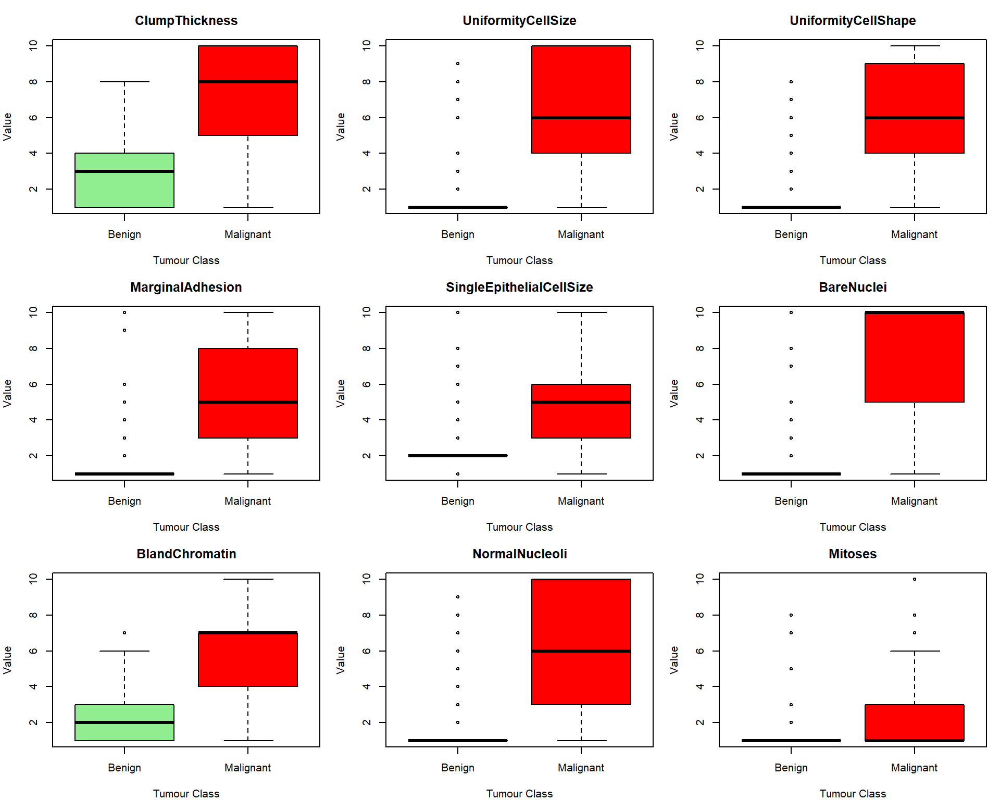
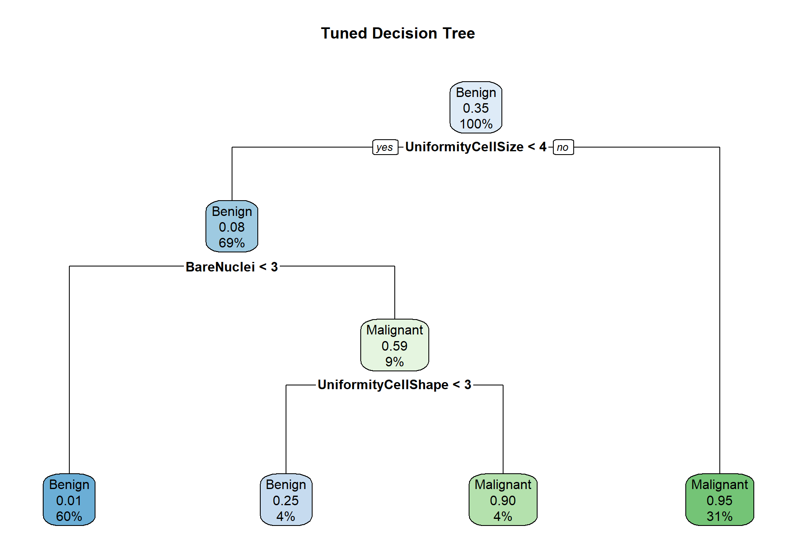
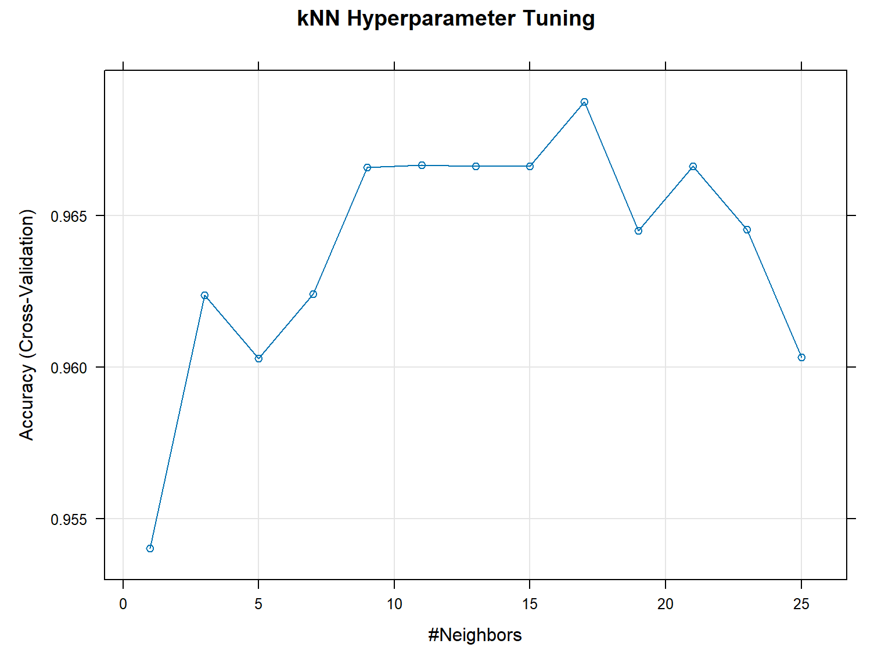
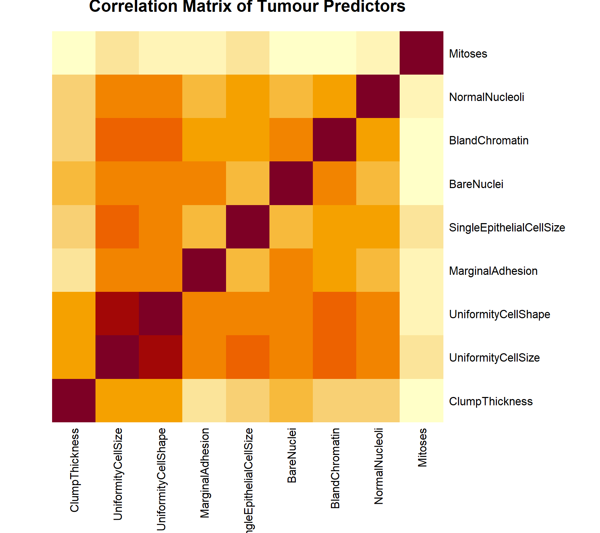

# Breast Cancer Classification in R (Decision Tree vs kNN)

Classifying breast tumours as benign or malignant from cytology measurements, using a tuned Decision Tree and a tuned k-Nearest Neighbours (kNN) model in R.

**Full report:** [View the rendered analysis (HTML)](https://samadnoman.github.io/msc-advanced-analytics-project/classification/breast_cancer_classification.html)

**Video walkthrough (10 min):** [Watch on YouTube](https://youtu.be/3JCD6dQ4xx0)

## Results

Both tuned models were evaluated on a held-out 30% test set (204 tumours). Malignant is the positive class.

| Metric | Decision Tree | kNN |
|---|---|---|
| Accuracy | 97.06% | **97.55%** |
| Sensitivity (recall) | 97.18% | 97.18% |
| Specificity | 96.99% | **97.74%** |
| Precision | 94.52% | **95.83%** |
| F1-score | 95.83% | **96.50%** |
| Balanced accuracy | 97.09% | **97.46%** |

kNN performed slightly better on most measures, so it was chosen as the preferred model. Both models caught the same share of malignant tumours (69 of 71), and the gap between them is small.

## Key insights

- **A few measurements carry most of the signal.** Malignant tumours score much higher on uniformity of cell size and shape, bare nuclei, bland chromatin and normal nucleoli.
- **A simple, explainable model comes close to the best one.** The tuned Decision Tree uses only three measurements (cell size uniformity, bare nuclei and cell shape uniformity) and still reaches 97.06% accuracy. Clinicians can read its rules directly.
- **Missed cancers are the costly error.** Each model missed 2 of the 71 malignant tumours in the test set. Further work would tune the models to cut these false negatives, even at the cost of more false alarms.

## Data

[Breast Cancer Wisconsin (Original)](https://archive.ics.uci.edu/dataset/15/breast), UCI Machine Learning Repository.

- 699 samples, 9 cell measurements scored from 1 to 10 (clump thickness, uniformity of cell size and shape, bare nuclei and others)
- 16 samples with a missing Bare Nuclei value were removed, leaving 683 (444 benign, 239 malignant)

## Method

1. **Data preparation:** loaded the raw file, renamed columns, handled missing values (`?` to `NA`) and converted the class to a labelled factor
2. **Exploratory analysis:** class balance, summary statistics, boxplots by class and a correlation matrix (strongest pair r ≈ 0.91)
3. **Train/test split:** stratified 70:30 split with `caret::createDataPartition` and a fixed seed
4. **Decision Tree:** baseline `rpart` model, then tuned the complexity parameter (cp) with 10-fold cross-validation (best cp = 0.045)
5. **kNN:** standardised predictors, then tuned k from 1 to 25 with 10-fold cross-validation (best k = 17)
6. **Evaluation:** confusion matrices on the unseen test set, plus sensitivity, specificity, precision, F1-score and balanced accuracy

## Video walkthrough

## Visuals

| Predictors by tumour class | Tuned Decision Tree |
|---|---|
|  |  |

| kNN tuning (cross-validated accuracy) | Correlation of predictors |
|---|---|
|  |  |

## Tools

R, R Markdown, caret, rpart, rpart.plot

## How to run

1. Clone the repo and open this folder in RStudio
2. Install the packages: `install.packages(c("caret", "rpart", "rpart.plot"))`
3. Knit `breast_cancer_classification.Rmd`. The data file sits in the same folder.

## Next steps

- Compare further models such as Random Forest and Support Vector Machines
- Use repeated cross-validation for a more stable performance estimate
- Tune the decision threshold to reduce false negatives, given the cost of missing a malignant tumour

---
Part 1 (classification) of my [MSc Advanced Analytics project](../). See also [Part 2: regression](../regression/). Dataset credit: Dr William H. Wolberg, University of Wisconsin Hospitals, via the UCI Machine Learning Repository.
