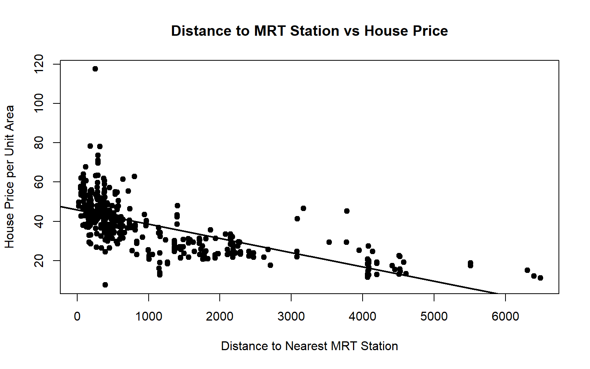
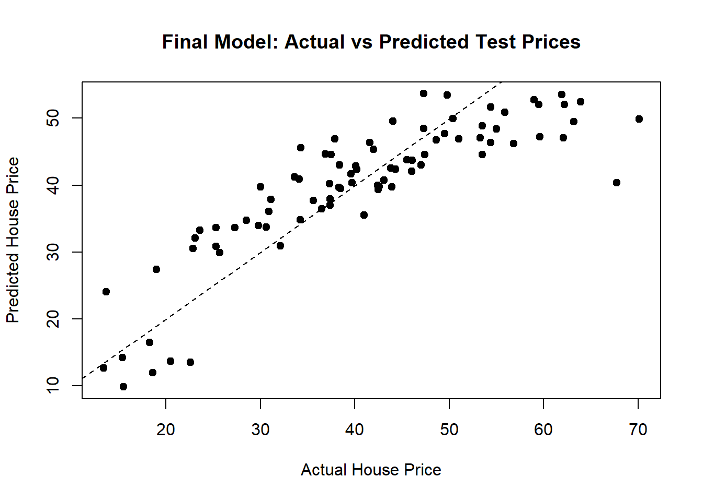
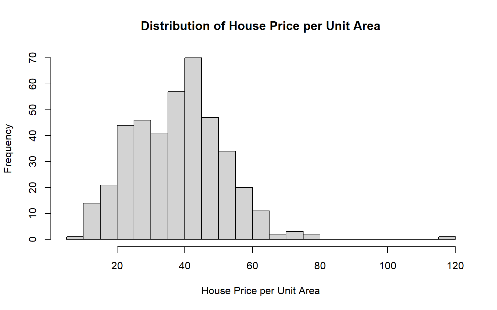
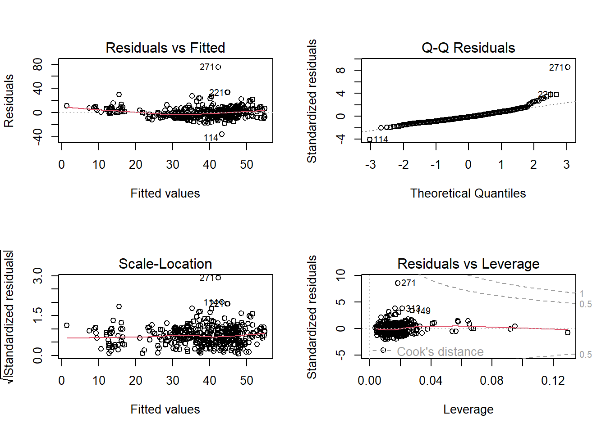

# House Price Prediction with Multiple Linear Regression in R

Modelling house price per unit area from location and property features, with full regression diagnostics and evaluation on a held-out test set.

**Full report:** [View the rendered analysis (HTML)](https://samadnoman.github.io/msc-advanced-analytics-project/regression/real_estate_regression.html)

## Results

| Measure | Value |
|---|---|
| R-squared (full data) | 0.582 (adjusted 0.576) |
| Test RMSE | 7.179 |
| Test MAE | 5.603 |
| Test MAPE | 15.34% |

- **Key drivers:** distance to the nearest MRT station (negative), number of nearby convenience stores (positive), house age (negative), transaction date and latitude were all significant at the 5% level. Longitude was not (p = 0.80).
- **Model choice:** a reduced model without longitude had a slightly lower AIC, but the full model gave marginally lower test errors, so the full model was kept.
- **No sign of overfitting:** test errors were no higher than training errors (training RMSE 8.782).

## Key insights

Each effect below holds the other factors constant.

- **Transport access matters most.** Every extra 100 m from the nearest MRT (metro) station is linked to a price about 0.45 units lower per unit area.
- **Local amenities add value.** Each additional nearby convenience store is linked to a price about 1.13 units higher.
- **Older homes sell for less.** Each extra year of house age is linked to a price about 0.27 units lower.
- **There is room to improve.** The model explains about 58% of price variation. The rest likely depends on details the data does not hold, such as floor area, floor level and condition.

## Data

[Real Estate Valuation](https://archive.ics.uci.edu/dataset/477/real+estate+valuation+data+set), UCI Machine Learning Repository. 414 property transactions with six predictors: transaction date, house age, distance to MRT station, number of convenience stores, latitude and longitude. There were no missing values.

## Method

1. **Data preparation:** checked structure, missing values and duplicates, renamed variables and removed the ID column
2. **Exploratory analysis:** price distribution, scatter plots against key predictors and a correlation matrix
3. **Multiple linear regression:** fitted with all six predictors and interpreted the coefficients and significance
4. **Diagnostics:**
   - multicollinearity with VIF (all below 5, highest 4.32)
   - residual normality with the Shapiro-Wilk test (residuals not normal)
   - constant variance with the Breusch-Pagan test (p = 0.206, no evidence of heteroscedasticity)
   - influential points with Cook's distance (19 flagged; checked and kept as valid records)
5. **Evaluation:** 80:20 train/test split with RMSE, MAE and MAPE
6. **Model comparison:** full vs reduced model using R-squared, adjusted R-squared, AIC and test-set errors

## Visuals

| Distance to MRT vs price | Actual vs predicted (test set) |
|---|---|
|  |  |

| Price distribution | Regression diagnostics |
|---|---|
|  |  |

## Tools

R, R Markdown, readxl, car (VIF), lmtest (Breusch-Pagan), caret

## How to run

1. Clone the repo and open this folder in RStudio
2. Install the packages: `install.packages(c("readxl", "car", "lmtest", "caret", "rpart", "rpart.plot"))`
3. Knit `real_estate_regression.Rmd`. The Excel data file sits in the same folder.

## Next steps

- Test non-linear terms, for example a log of MRT distance, and interaction effects
- Compare with tree-based models such as Random Forest
- Use repeated cross-validation instead of a single split

---
Part 2 (regression) of my [MSc Advanced Analytics project](../). See also [Part 1: classification](../classification/). Dataset credit: I-Cheng Yeh, via the UCI Machine Learning Repository.
